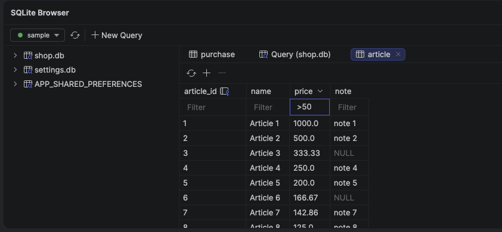
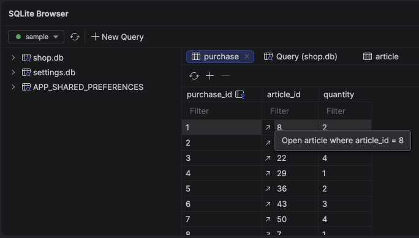
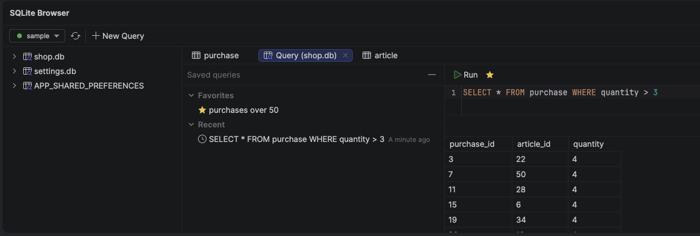

# Live SQLite for Android

Browse and edit your debug app's SQLite databases, live, in a tool window in Android Studio.



## Why

This plugin does the same job as the App Inspection's Database Inspector plus more features (a filter box under every column, foreign keys you can follow to the rows they reference and favorite queries per database)

## Features

- **Filter by column.** Every column has a filter box under its header. Type and the table narrows down as you go, across the whole table, not just the visible page.
  - Plain text matches anywhere in the value, ignoring case: `alice` finds `Alice Smith`.
  - Start with an operator to compare instead: `=3`, `!=draft`, `>100`, `<=2026-01-01`. Numbers are compared as numbers.
  - Filters in several columns combine: a row must match all of them.
- **Sort by any column.** Click a header to sort the whole table by it: once ascending, twice descending, a third time back to table order.
- **Big tables are fine.** Rows load 500 at a time, so a table with hundreds of thousands of rows opens fast and doesn't run your app out of memory.
- **Follow foreign keys.** A cell of a foreign key column has an arrow: click it (or right-click the cell) to open the table it refers to in a new tab, filtered to the rows with that value, e.g. the article a purchase names. Its filter box holds `=value`; clear it to see the whole table. Close the tab to go back to where you came from. Keys over several columns aren't followed.

  

- **Tabs.** All databases and their tables sit in a tree; double-click a table to open it in its own tab. Keep several tables from several databases open side by side.
- **Picks up where you left off.** The plugin remembers the device, port and open tabs. Next time, it reconnects by itself if the same app is running.
- **Edit the data.** Double-click a cell to change it, right-click it to set it to NULL. **Add Row** inserts a row; columns you leave empty get their default. Select rows and press Delete (or **Delete**) to remove them. Changes go straight into the app's database.
  - Editing and deleting rows need a table with a single-column primary key, which picks the row. Other tables can only get new rows.
  - The key itself can't be changed.
  - Typing the text `null` stores NULL: debug-db can't tell them apart.
  - NULL shows as a grey `NULL`, so it doesn't look like an empty string.
  - Your app's screens may not show the change right away: see [Limitations](#limitations).
- **Refresh** a tab to see what your app wrote since.
- **Your own SQL.** Press **New Query** above the tree to write SQL for the selected database; with a table selected, it starts as `SELECT * FROM` that table. Right-clicking a database or table does the same. Press **Run** (⌘⏎ or Ctrl+Enter); with text selected, only the selection runs.

  

  - A `SELECT` (or `WITH … SELECT`) loads 500 rows at a time, and you can sort it by clicking a header, like a table.
  - Several statements separated by `;` run in order, and you see the result of the last one. Paging and sorting run only that last `SELECT` again, never the statements before it.
  - Writes (`UPDATE`, `INSERT`, `DELETE`, …) go straight into the app's database, but Room doesn't notice them: see [Limitations](#limitations). Query results can't be edited in the grid.
  - The SQL is kept when you restart Android Studio, but it doesn't run until you press **Run**.
  - **New Query** on a database starts with the SQL you last ran there, even after you closed its tab. On a table, it starts with `SELECT * FROM` that table.
  - The list beside the editor shows the database's **Favorites** and its 20 most **Recent** queries. Click one to open it: a query that only reads (`SELECT`, `PRAGMA table_info(…)`, …) runs right away; one that may change data waits for **Run**. It replaces the editor's SQL when that is empty or saved too, and otherwise opens in a new tab. The list button next to **Run** hides the list in all tabs.
  - The ☆ next to **Run** adds the editor's SQL to Favorites, named after its first line, and removes it again. Right-click a favorite (or press F2) to rename it, or a recent query to add it to Favorites. Favorites and recent queries are kept per app and database, in all your projects.
  - The editor highlights SQL and completes keywords and the database's table and column names (Ctrl+Space). It learns the names when the tab opens, on reconnect, and after you run `CREATE`, `DROP` or `ALTER`.

## Limitations

**Room doesn't see your edits right away.** When you change data in the plugin (editing a cell, adding or deleting rows, or running `UPDATE`, `INSERT` or `DELETE` in a query tab), screens that watch the data through Room (`Flow`, `LiveData`, `PagingSource`) don't update. They show the change the next time they query the database, for example when you reopen the screen or restart the app.

Room learns about changes from triggers that only fire for writes on its own connection, and debug-db writes on a separate one. Android Studio's Database Inspector tells Room after each change, so its edits show up right away.

## Usage

### 1. Add debug-db to your app

The plugin reads the databases through [Android-Debug-Database](https://github.com/amitshekhariitbhu/Android-Debug-Database) (debug-db), a small server that runs inside your app's debug build only.

In the app's `settings.gradle.kts`, add JitPack:

```kotlin
dependencyResolutionManagement {
    repositories {
        maven { setUrl("https://jitpack.io") }
    }
}
```

In the app module's `build.gradle.kts`:

```kotlin
debugImplementation("com.github.amitshekhariitbhu.Android-Debug-Database:debug-db:1.0.7")
```

`debugImplementation` keeps it out of your release build.

### 2. Install the plugin

Needs Android Studio 2025.3 (Panda) or newer.

There is no Marketplace release yet. Build the plugin from this repository:

```bash
./gradlew buildPlugin
```

Then in Android Studio: *Settings → Plugins → ⚙ → Install Plugin from Disk*, and pick `build/distributions/sqlite-browser-0.1.0.zip`.

### 3. Connect

1. Run your app's debug build on an emulator or phone. debug-db starts by itself on port 8080.
2. Open the **SQLite Browser** tool window at the bottom of Android Studio.
3. Pick the device, keep port 8080, and press **Connect**.
4. Expand a database in the tree and double-click a table.

### More than one debug app on the device?

Only one app can use port 8080. If another debug app with debug-db holds it, the plugin shows that app's name next to the port, and you'd be looking at the wrong data. Give your app its own port by adding this to its `res/values/strings.xml` (debug-db reads it):

```xml
<string name="PORT_NUMBER">8081</string>
```

Then connect on 8081.

## Contributing

See [CONTRIBUTING.md](CONTRIBUTING.md) for building, running the plugin from source and how the code works. Ideas and what's planned are in [IDEAS.md](IDEAS.md).

## License

Apache 2.0, like debug-db.
